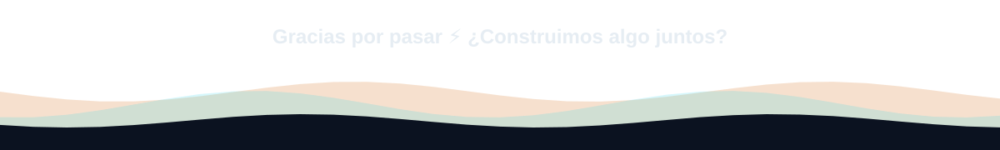

 

## ⚡ Sobre mí

## 🧰 Caja de herramientas

**Datos & BI** 

**Automatización & IA** 

**Web** 

## 🚀 Proyectos destacados

  
  
  
  

<b>⛏️ Más proyectos de ingeniería y datos</b>

 

| Proyecto | Tema |
|---|---|
| [Compositación de sondajes](https://github.com/Monokhan/Compositacion-de-sondajes-mineros-en-python) | Minería · Python |
| [Malla de tronadura a cielo abierto](https://github.com/Monokhan/Malla-de-tronadura-Cielo-Abierto-en-python) | Minería · Python |
| [Estabilidad de taludes (Fellenius)](https://github.com/Monokhan/Estabilidad-de-Talud-aplicacion-del-metodo-de-Fellenius) | Geotecnia · Python |
| [Rendimiento de equipos de carguío y transporte](https://github.com/Monokhan/Analisis-de-desempe-o-de-rendimiento-de-equipos-de-Carguio-y-Transporte-en-mineria.) | Minería · Datos |
| [Extractor de PDF a Excel](https://github.com/Monokhan/Extractor-de-datos-PDF-a-Excel-infomes-de-inspeccion-Doland) | Automatización |
| [Análisis de transporte logístico](https://github.com/Monokhan/Analisis-de-transporte-logistico-con-Python) | Datos · Python |
| [Predictor de precios de automóviles](https://github.com/Monokhan/Predictor-de-precios-de-automoviles) | Machine Learning |
| [Análisis de ventas con SQL y Tableau](https://github.com/Monokhan/Analisis-de-ventas-con-SQL-y-Tableau) | SQL · BI |

## 📈 En movimiento

  
  
    
  <picture>
    <source media="(prefers-color-scheme: dark)" srcset="https://raw.githubusercontent.com/Monokhan/Monokhan/output/github-snake-dark.svg"/>
    
  </picture>

## 🎧 Mientras programo

  <!-- Reemplaza el enlace por tu playlist de Spotify -->
  

